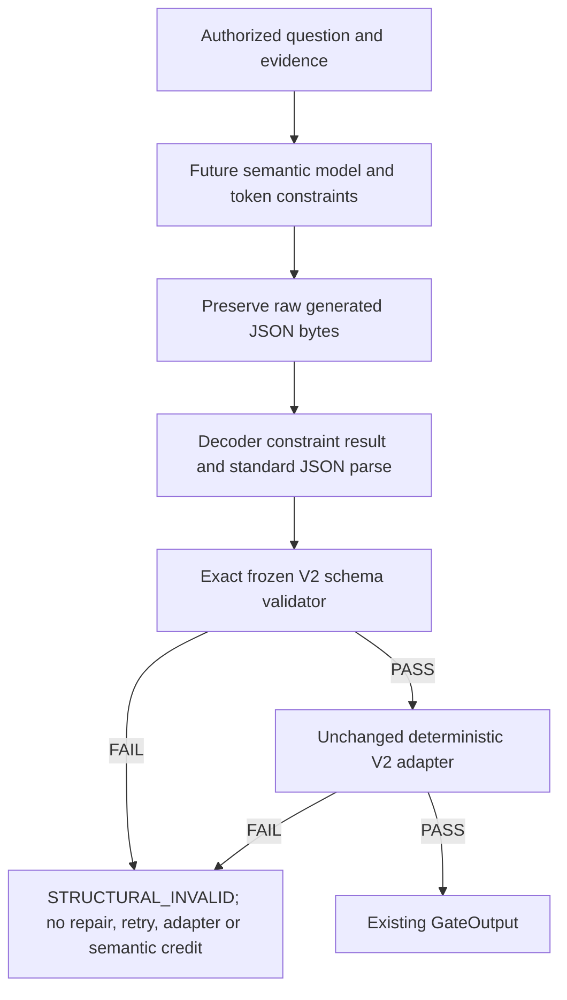

# A2.1-P responsibility split preregistration

Outcome: RESPONSIBILITY_SPLIT_PREREGISTERED.
Owner state: CANDIDATE_AWAITING_OWNER_REVIEW. No owner approval is inferred.

Base HEAD/tag answerability-semantic-v2-llguidance-v0.1-prereg-blocked resolved to f0eea245c34ca9fe707d287aa17ff59a913490f2; entry working tree/index clean. The architecture separates preventive token-level structured generation from complete authoritative raw-schema validation. Historical decoder investigations motivate that separation for this exact frozen contract; they do not prove universal decoder impossibility.

Implementation identity: SEMANTIC_MATERIAL_SUPPORT_V2_1. Semantic meaning, material-ask rules, policy context, reason codes, rank references and deterministic adapter semantics remain V2. Original V2 source/registry stays frozen; this separate registry records the architecture change. No runtime implementation, decoder, validator package or new prompt variant is selected here.

Authoritative schema remains RAW_ASSESSMENT_SCHEMA_V2.json at SHA-256 6fd9429c6238525dadf259d8a3b2b877b0da2b9bc1c2e8f44c42bbe1d07dfc1e. The inventory reads declarations only. No schema bytes were normalized/reordered/rewritten and no schema instance validation or decoder execution occurred.

Every material raw-schema keyword occurrence is CRITICAL and EXACT_VALIDATOR_ENFORCED. The unconditional structural spine additionally belongs to the decoder. Branch predicates stay in their original context at the exact validator; their full values/pointers remain inventoried. Delegation changes the generation mechanism, never final acceptance. No material constraint is unowned.

Allowed future operations: preserve/parse raw bytes, validate the raw object and reject invalid output. NO POST-GENERATION REPAIR. Prohibited: add/drop fields, deduplicate/sort arrays, rewrite enums/types/ranks/conditionals, repair malformed JSON, or retry after structural failure. Invalid raw bytes and failures must be preserved; no automatic ABSTAIN or semantic accuracy credit.

This phase authors architecture declarations and offline checks only. No decoder selected, installed, imported or executed. No tokenizer/model/semantic/retrieval calls, network or benchmark access. Fresh V2/V2.1 suite NOT YET AUTHORED. P2 and later steps require predecessor completion and separate authorization; no implicit progression follows these artifacts.
